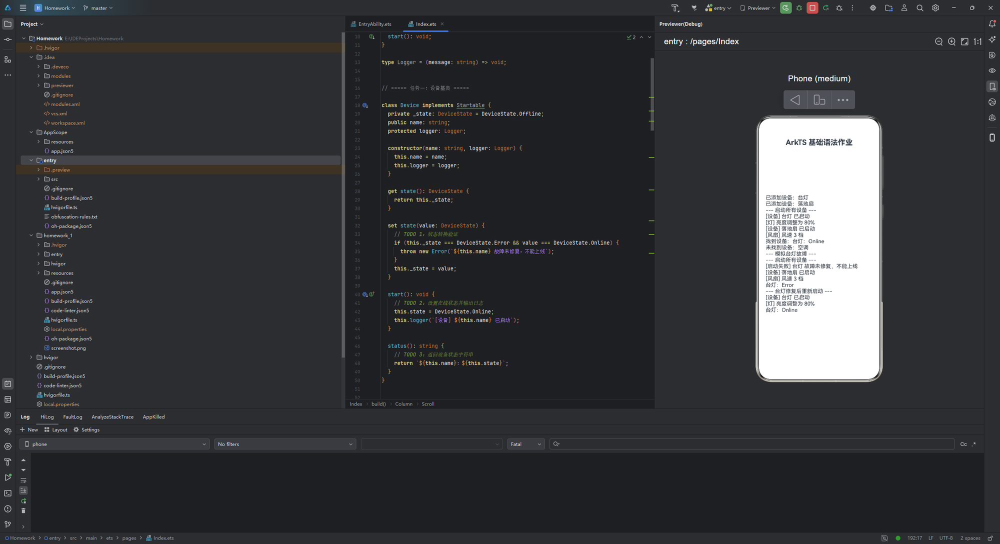

# ArkTS 智能设备管理系统 - 作业报告

## 作业要求

补全8处代码片段，实现一个"智能设备管理系统"，涵盖以下概念：

- **TODO 1-3**：设备基类实现（状态管理、启动方法、状态查询）
- **TODO 4-5**：子类重写启动方法（智能灯输出亮度、风扇输出风速）
- **TODO 6-8**：管理器功能（添加设备、批量启动、按名称查询）

## 关键代码片段

### TODO 1-3: Device 基类

```typescript
class Device implements Startable {
  private _state: DeviceState = DeviceState.Offline;
  public name: string;
  protected logger: Logger;

  set state(value: DeviceState) {
    // TODO 1: 状态转换验证
    if (this._state === DeviceState.Error && value === DeviceState.Online) {
      throw new Error(`${this.name} 故障未修复，不能上线`);
    }
    this._state = value;
  }

  start(): void {
    // TODO 2: 设置在线状态并输出日志
    this.state = DeviceState.Online;
    this.logger(`[设备] ${this.name} 已启动`);
  }

  status(): string {
    // TODO 3: 返回设备状态字符串
    return `${this.name}：${this.state}`;
  }
}
```

### TODO 4-5: 子类重写

```typescript
class SmartLight extends Device {
  start(): void {
    // TODO 4: 调用父类启动并输出亮度信息
    super.start();
    this.logger(`[灯] 亮度调整为 ${this.brightness}%`);
  }
}

class Fan extends Device {
  start(): void {
    // TODO 5: 调用父类启动并输出风速信息
    super.start();
    this.logger(`[风扇] 风速 ${this.speed} 档`);
  }
}
```

### TODO 6-8: 管理器

```typescript
class DeviceManager {
  private devices: Device[] = [];

  add(device: Device): void {
    // TODO 6: 添加设备到数组
    this.devices.push(device);
    this.logger(`已添加设备：${device.name}`);
  }

  startAll(): void {
    for (const device of this.devices) {
      try {
        // TODO 7: 遍历启动设备，异常处理
        device.start();
      } catch (error) {
        this.logger(`[启动失败] ${(error as Error).message}`);
      }
    }
  }

  find(name: string): Device | null {
    // TODO 8: 按名称查询设备
    for (const device of this.devices) {
      if (device.name === name) {
        return device;
      }
    }
    return null;
  }
}
```

## 运行结果



应用启动时在屏幕上显示以下输出日志：

```
已添加设备：台灯
已添加设备：落地扇
--- 启动所有设备 ---
[设备] 台灯 已启动
[灯] 亮度调整为 80%
[设备] 落地扇 已启动
[风扇] 风速 3 档
找到设备：台灯：Online
未找到设备：空调
--- 模拟台灯故障 ---
--- 启动所有设备 ---
[启动失败] 台灯 故障未修复，不能上线
[设备] 落地扇 已启动
[风扇] 风速 3 档
台灯：Error
--- 台灯修复后重新启动 ---
[设备] 台灯 已启动
[灯] 亮度调整为 80%
台灯：Online
```

**执行说明**：
1. 创建台灯（亮度80%）和落地扇（风速3档），添加到管理器
2. 启动所有设备，两个设备都成功启动并输出各自的特有信息
3. 查询台灯（找到）和空调（未找到）
4. 将台灯状态改为故障，尝试重新启动
5. 异常被捕获，输出启动失败信息，其他设备继续启动
6. 修复台灯（改为Offline），重新启动成功

## 思考题解答

**Q1: 为什么要通过 setter 而不是直接修改私有字段？**

通过 setter 可以在赋值前执行验证逻辑。如果直接修改 `_state` 字段，无法进行合法性检查，对象可能进入非法状态。

**Q2: super 关键字的作用是什么？**

在子类方法中调用 `super.start()` 能够执行父类的方法，然后在其基础上追加子类特定的逻辑。

**Q3: 为什么子类对象能存储在 Device[] 数组中？**

这是面向对象中的多态性。子类对象满足父类的接口契约，因此可以作为父类类型使用和存储。

**Q4: Device | null 类型中的'|'表示什么？**

表示"或"关系，返回值可能是 `Device` 类型也可能是 `null`。调用方需判断返回值是否为 null，来区分"找到设备"和"未找到设备"两种情况。

**Q5: 如果设备在 Error 状态，还能改为 Online 吗？**

不能。setter 中有验证逻辑：当 `_state === Error && value === Online` 时会抛出异常。需要先改为 `Offline`（表示修复），才能再启动到 `Online` 状态。

---

**代码位置**：`homework_1/entry/src/main/ets/pages/Index.ets`  
**完成情况**：8/8 TODO 完成 ✓
