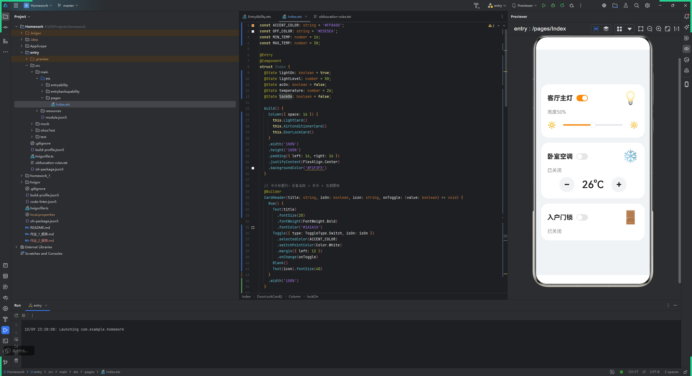

# UI 界面实现 - 作业报告

## 作业要求

在 `Index.ets` 中完成智能家居设备控制界面，界面包含三张设备卡片：

- **客厅主灯**：开关 + 亮度文字 + 亮度滑块（两端为暗/亮图标）
- **卧室空调**：开关 + 状态文字 + 温度调节（`−` / 温度 / `+`）
- **入户门锁**：开关 + 状态文字

页面为浅灰底，设备以白色圆角卡片展示，开关打开时为橙色。

## 关键代码片段

### 页面结构

三张卡片使用 `@Builder` 拆分，在 `build()` 中垂直排列：

```typescript
build() {
  Column({ space: 16 }) {
    this.LightCard()
    this.AirConditionerCard()
    this.DoorLockCard()
  }
  .width('100%')
  .height('100%')
  .padding({ left: 16, right: 16 })
  .justifyContent(FlexAlign.Center)
  .backgroundColor('#F1F3F5')
}
```

### 复用的卡片标题行

三张卡片的标题行（名称 + 开关 + 右侧图标）结构一致，抽成一个带回调参数的 `@Builder`：

```typescript
@Builder
CardHeader(title: string, isOn: boolean, icon: string, onToggle: (value: boolean) => void) {
  Row() {
    Text(title).fontSize(20).fontWeight(FontWeight.Bold)
    Toggle({ type: ToggleType.Switch, isOn: isOn })
      .selectedColor(ACCENT_COLOR)
      .switchPointColor(Color.White)
      .margin({ left: 12 })
      .onChange(onToggle)
    Blank()
    Text(icon).fontSize(40)
  }
  .width('100%')
}
```

### 亮度滑块与状态联动

```typescript
Text(this.lightOn ? `亮度${this.lightLevel}%` : '已关闭')

Slider({ value: this.lightLevel, min: 0, max: 100, style: SliderStyle.OutSet })
  .selectedColor(ACCENT_COLOR)
  .trackColor(OFF_COLOR)
  .onChange((value: number): void => {
    this.lightLevel = Math.round(value);
  })
```

### 空调温度调节

```typescript
this.RoundButton('−', (): void => {
  if (this.temperature > MIN_TEMP) {
    this.temperature--;
  }
})
Text(`${this.temperature}°C`).fontSize(32)
this.RoundButton('+', (): void => {
  if (this.temperature < MAX_TEMP) {
    this.temperature++;
  }
})
```

温度被限制在 16°C ~ 30°C 之间。

## 运行结果



初始状态：客厅主灯开启、亮度 50%；卧室空调关闭、26°C；入户门锁关闭。
拖动滑块时亮度文字实时变化，点击 `−` / `+` 调节温度，开关可切换各设备状态文字。

## 思考题解答

**Q1: 为什么用 `@State` 修饰状态变量？**

`@State` 变量变化时会触发所在组件重新渲染，界面与数据自动保持一致；普通变量修改后界面不会刷新。

**Q2: `@Builder` 的作用是什么？**

把重复或较长的 UI 片段抽成可复用的方法，使 `build()` 更清晰。本作业中三张卡片共用 `CardHeader`，避免了重复代码。

**Q3: 如何实现"开关 / 滑块 / 按钮"的交互？**

分别通过 `Toggle.onChange`、`Slider.onChange`、`Text.onClick` 回调修改对应的 `@State` 变量，界面随之更新。

---

**代码位置**：`homework_2/entry/src/main/ets/pages/Index.ets`
