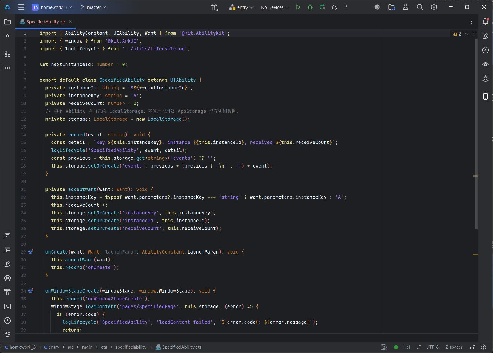
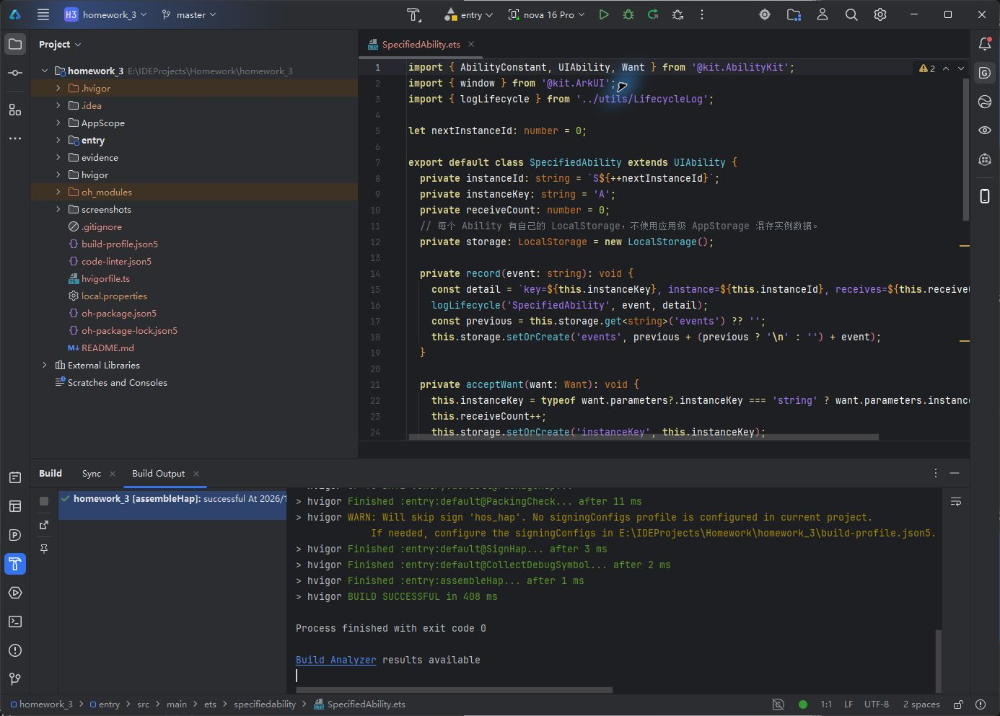
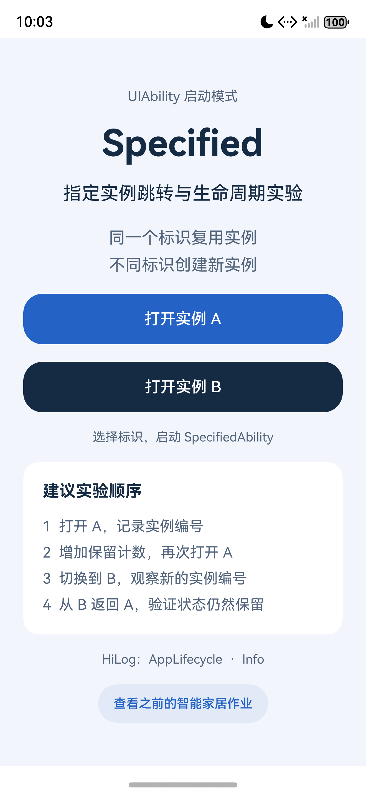
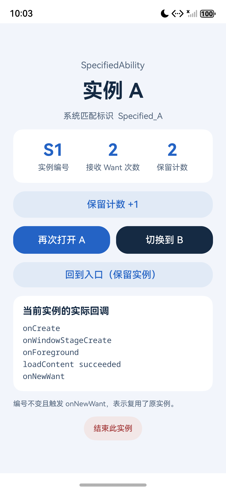
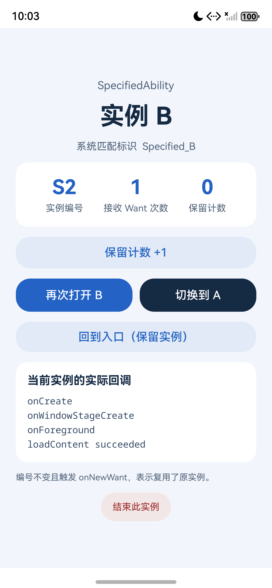
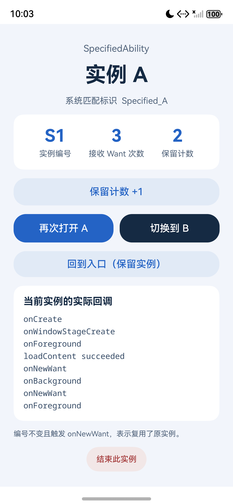
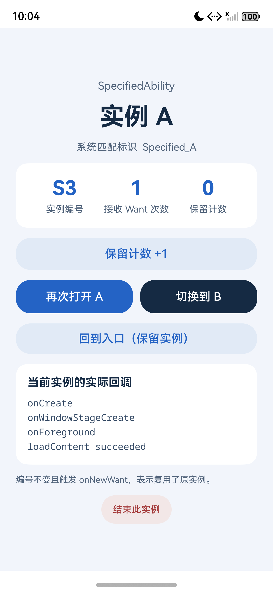
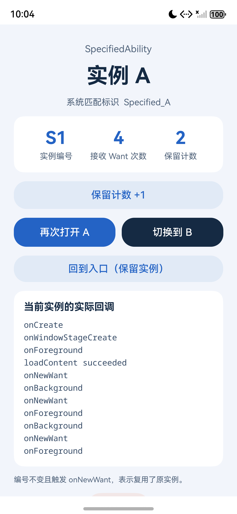

# HarmonyOS 应用开发课程作业报告

**作业三 Specified Ability 跳转与生命周期分析**

## 一 作业要求

实现到 SpecifiedAbility 的跳转，通过截图和日志分析生命周期。使用 A、B 两个标识，验证相同标识复用、不同标识新建、实例状态独立保存以及销毁后重新创建。

## 二 开发环境

开发工具为 DevEco Studio 6.0.2.640；开发语言为 ArkTS，界面使用 ArkUI，应用采用 Stage 模型。编译 SDK 和兼容版本均为 HarmonyOS 6.0.2 API 22。

运行设备为 nova 16 Pro 模拟器，系统为 HarmonyOS 6.0.2 API 22。报告采用 2026 年 10 月 27 日实际运行的截图和 AppLifecycle 日志。

## 三 设计思路

### 1 通过业务标识选择实例

入口按钮通过 UIAbilityContext.startAbility() 传入 instanceKey。MyAbilityStage.onAcceptWant() 将 A、B 分别映射为 Specified_A、Specified_B，系统据此选择已有实例或创建新的 SpecifiedAbility。这里是 Ability 之间的跳转，不是页面 router 路由。

### 2 用可观察状态证明复用

每个新对象分配一个进程内编号，例如 S1、S2；每次接收 Want 时累计次数。页面另有可手动增加的保留计数。编号相同、接收次数增加、保留计数不变，并出现 onNewWant，共同说明原对象被复用。

## 四 关键实现

### 1 配置指定实例模式

module.json5 注册目标 Ability，模块 srcEntry 指向 MyAbilityStage。入口使用 singleton，目标使用以下配置：

```typescript
{
  "name": "SpecifiedAbility",
  "srcEntry": "./ets/specifiedability/SpecifiedAbility.ets",
  "launchType": "specified",
  "removeMissionAfterTerminate": true,
  "exported": false
}
```

### 2 启动目标 Ability 并传参

openSpecified() 使用调用方包名和目标 Ability 发起显式启动，调用处处理错误。

```typescript
const want: Want = {
  bundleName: context.abilityInfo.bundleName,
  moduleName: 'entry',
  abilityName: 'SpecifiedAbility',
  parameters: { instanceKey: key }
};
await context.startAbility(want);
```

### 3 在 onAcceptWant 中返回稳定标识

```typescript
  onAcceptWant(want: Want): string {
    if (want.abilityName === 'SpecifiedAbility') {
      const key = typeof want.parameters?.instanceKey === 'string'
        ? want.parameters.instanceKey : 'A';
      const flag = `Specified_${key}`;
      logLifecycle('AbilityStage', 'onAcceptWant',
        `key=${key}, flag=${flag}`);
      return flag;
    }
    return `${want.bundleName}_${want.abilityName}`;
  }
```

### 4 在新建与复用时更新状态

```typescript
private storage: LocalStorage = new LocalStorage();
// onCreate 中同样调用 acceptWant 和 record。
onNewWant(want: Want,
  launchParam: AbilityConstant.LaunchParam): void {
  this.acceptWant(want);
  this.record('onNewWant');
}
// onWindowStageCreate 使用 loadContent 将 storage 传给页面。
```

### DevEco 中的作业工程

独立工程位于 homework_3。下图为 DevEco Studio 实际打开的工程与 SpecifiedAbility 文件。完整源码和 SDK 构建日志随工程保存，运行结果见后续模拟器截图。



*图 1 DevEco Studio 打开的独立作业工程*

DevEco 内置的 **Build Hap(s)** 构建也已通过，输出 `BUILD SUCCESSFUL`，进程退出码为 `0`。以下为实际构建成功截图；模拟器使用未签名 HAP，真机安装需配置调试签名。



### 核心文件分工

| 文件 | 作用 |
| --- | --- |
| pages/LaunchPage.ets | 提供 A 和 B 的启动入口 |
| utils/AbilityLauncher.ets | 统一封装 startAbility 跳转 |
| myabilitystage/MyAbilityStage.ets | 返回指定实例的匹配标识 |
| specifiedability/SpecifiedAbility.ets | 记录实例编号和生命周期 |
| pages/SpecifiedPage.ets | 展示当前实例并验证状态保留 |

## 五 运行效果

### 1 从入口打开 A

先启动 EntryAbility，点击“打开实例 A”。目标页面显示 key 为 A、实例编号 S1，接收 Want 次数为 1、保留计数为 0，说明第一次启动创建了新实例。以下均为模拟器原始屏幕截图。

| 实验入口提供打开实例 A 和 B 的按钮 | A 首次打开，编号 S1，接收次数 1，保留计数 0 |
| --- | --- |
|  |  |

*图 2 实验入口                         图 3 A 首次创建为 S1*

右图的当前实例回调包含 onCreate、onWindowStageCreate、onForeground 和 loadContent succeeded；下文结合原始日志分析这些事件。

### 2 相同标识复用与不同标识新建

在 A 中将保留计数增加到 2，再点击“再次打开 A”。随后点击“切换到 B”，观察两个动作的不同结果。

| 再次打开 A，仍为 S1，接收次数 2，保留计数 2，并新增 onNewWant | 打开 B，新实例编号 S2，接收次数 1，保留计数 0 |
| --- | --- |
|  |  |

*图 4 相同标识 A 复用 S1              图 5 不同标识 B 新建 S2*

左图：S1 没有变化，接收次数由 1 变为 2，保留计数仍为 2，回调列表新增 onNewWant。右图：B 对应新的 S2，接收次数和保留计数独立初始化，未覆盖 A 的状态。

### 3 返回旧实例与销毁后重建

从 B 切回 A，验证 A 的状态保留。之后在 A 页面点击“结束此实例”，返回入口再次打开 A，验证已销毁的实例不会继续复用。

| 从 B 返回 A，仍为 S1，接收次数 3，保留计数 2 | S1 销毁后再次打开 A，创建新实例 S3，接收次数 1，计数 0 |
| --- | --- |
|  |  |

*图 6 返回已有的 A 实例 S1             图 7 销毁后新建 A 实例 S3*

| 操作 | 编号 | 接收次数 | 保留计数 |
| --- | --- | --- | --- |
| A 首次打开 | S1 | 1 | 0 |
| A 前台再次打开 | S1 | 2 | 2 |
| 从 B 返回 A | S1 | 3 | 2 |
| 销毁 A 后再次打开 | S3 | 1 | 0 |
| 重新打开仍存活的 B | S2 | 2 | 1 |

## 六 生命周期分析

标签为 AppLifecycle，级别为 Info。以下节选保留实际序号和消息，省略系统时间、进程及追踪链，Specified 为范围名缩写。原文保存在 evidence/AppLifecycle.log。

### 1 首次打开 A

```text
[15] AbilityStage onAcceptWant | key=A, flag=Specified_A
[20] Specified onCreate | key=A, instance=S1, receives=1
[22] Specified onWindowStageCreate | key=A, instance=S1, receives=1
[24] Specified onForeground | key=A, instance=S1, receives=1
[26] Specified loadContent succeeded | key=A, instance=S1, receives=1
```

返回 Specified_A 后，系统创建 S1，再创建窗口并进入前台。loadContent 成功回调在本次 onForeground 之后执行，属于异步加载通知。

### 2 A 已在前台时再次打开 A

```text
[31] AbilityStage onAcceptWant | key=A, flag=Specified_A
[32] Specified onNewWant | key=A, instance=S1, receives=2
```

复用 S1 时只新增 onNewWant，没有再次执行 onCreate 或 onWindowStageCreate。由于 A 原本已在前台，本次也未新增 onForeground。

### 3 从后台恢复 A

```text
[50] AbilityStage onAcceptWant | key=A, flag=Specified_A
[51] Specified onNewWant | key=A, instance=S1, receives=3
[53] Specified onForeground | key=A, instance=S1, receives=3
```

A 从后台恢复时，先接收 onNewWant，再执行 onForeground。页面另有 onPageShow；页面与 Ability 事件属于不同层次，不应混为固定的单一顺序。

### 4 主动结束 A

```text
[84] Specified onBackground | key=A, instance=S1, receives=4
[88] Specified onWindowStageDestroy | key=A, instance=S1, receives=4
[90] Specified onDestroy | key=A, instance=S1, receives=4
```

terminateSelf() 触发上述销毁事件，页面另有 onPageHide、aboutToDisappear。再次打开 A 得到 S3 并触发 onCreate，说明 S1 已结束。系统强制结束进程时，不保证有相同的完整回调。

## 七 问题与解决

### 1 匹配标识必须包含业务参数

如果 onAcceptWant 只返回 Ability 名称，A、B 就会被映射为同一个标识，无法演示指定实例模式的区分行为。本实现返回 Specified_ 加上 instanceKey，保证同一 key 稳定、不同 key 可区分。

### 2 多实例状态需要隔离

使用同一份全局存储会使多个页面互相覆盖。本实现由每个 Ability 持有 LocalStorage，再通过 loadContent 传入页面。实际验证中 A 的计数为 2 时，B 可以独立增加到 1，且返回 A 后仍为 2。

### 3 日志级别与实际事件

生命周期日志通过 hilog.info 输出，因此应筛选 Info 和 AppLifecycle。仅筛选 Fatal 无法看到正常回调。判断是否新建，应结合对象编号及 onCreate/onNewWant，不能只根据画面相同作结论。

## 八 总结与参考资料

本次完成了 EntryAbility 到 SpecifiedAbility 的跳转。A、B 分别创建 S1、S2；同一标识再次打开时保留对象及页面状态，通过 onNewWant 接收新的启动请求；主动销毁 A 后重新创建 S3。实验说明，specified 模式的关键是由 AbilityStage 返回稳定的业务标识，再由系统管理实例复用。

完整工程包含可编译源码、9 张运行截图、完整生命周期日志以及验证结果 JSON。保留计数仅用于说明存活实例的内存状态，不是跨进程或跨安装的数据持久化。实例编号也只在当前进程内有效。

参考资料：OpenHarmony 官方文档 UIAbility 组件启动模式，specified 启动模式章节。

https://github.com/openharmony/docs/blob/master/zh-cn/application-dev/application-models/uiability-launch-type.md

## 附录 补充验证截图与提交材料

回到入口再次打开 A，仍复用 S1；重新打开 B 时，B 仍为 S2 且保留计数为 1。最后切回已重建的 A 时，A 仍为 S3。以下补充截图与前文共同覆盖全部 9 张运行截图。

| 从入口返回 A | B 独立保留状态 | 返回重建后的 A |
| --- | --- | --- |
|  |  |  |

- [完整生命周期日志](homework_3/evidence/AppLifecycle.log)
- [交互验证结果](homework_3/evidence/verification.json)：六项断言全部通过。
- [SDK 构建日志](homework_3/evidence/build.log)
- [模拟器使用的 HAP](homework_3/dist/作业3-Specified-unsigned.hap)
- [工程说明](homework_3/README.md)
