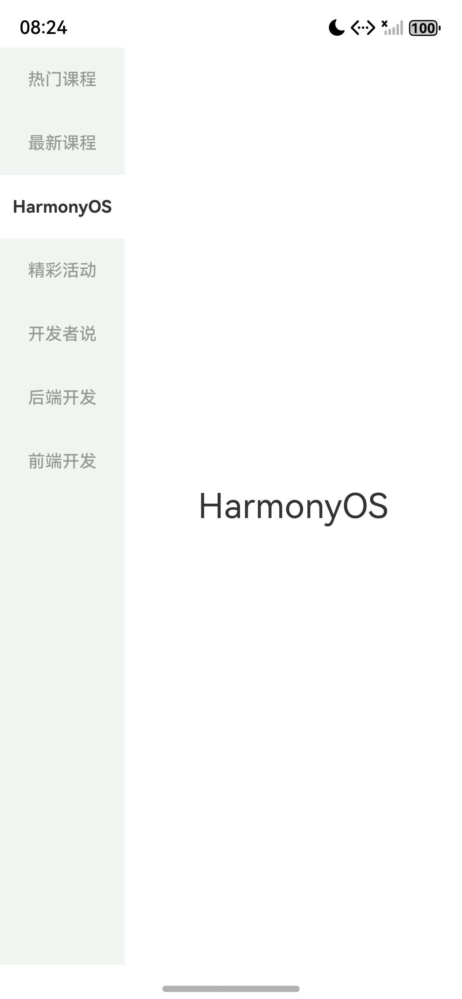
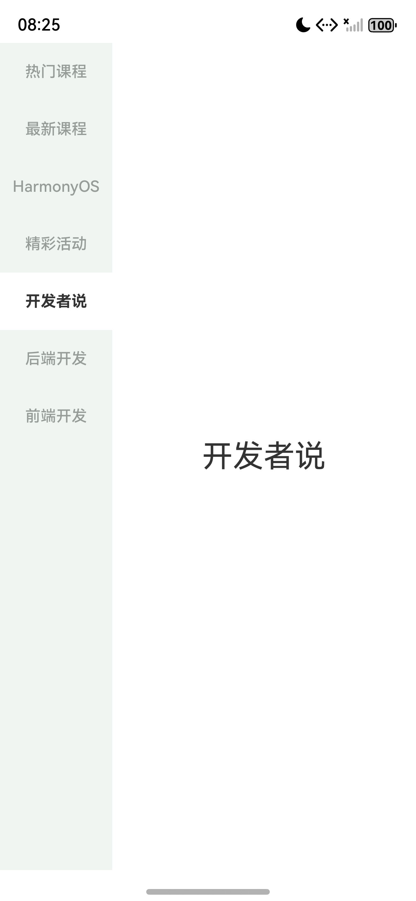

# 作业四 纵向 Tabs 课程分类页面

[Word 实验报告](作业_4_报告.docx) · [完整长图](作业_4_报告_长图.png)

本次作业完成一个左侧选择分类、右侧显示分类标题的 HarmonyOS 页面。页面初始定位在“精彩活动”，七个入口按题目顺序纵向排列；点击分类或在内容区上下滑动时，标题和左侧选中样式一起更新。

工程采用 ArkTS 声明式界面，页面实现集中在 Index.ets。分类数组提供页面顺序和文字，自定义 Builder 绘制左栏标签，selectedIndex 连接当前页与标签样式。下面按数据生成、页面布局和事件更新说明实现，并结合运行画面核对结果。

## 1 用分类数组生成标签与内容

Index 中的 categories 属性保存七个分类字符串，并用 readonly 修饰。ForEach 同时取得 title 与 index，为每个分类生成一个 TabContent，再将 categoryTab(title, index) 传给 tabBar。左栏标签和右侧标题使用同一个 title，数组位置也就是 Tabs 的页面索引。

| 页面索引 | 分类标题 |
| --- | --- |
| 0 | 热门课程 |
| 1 | 最新课程 |
| 2 | HarmonyOS |
| 3 | 精彩活动 |
| 4 | 开发者说 |
| 5 | 后端开发 |
| 6 | 前端开发 |

selectedIndex 用 @State 声明，初值为 3，因此第一次进入时显示数组中的“精彩活动”。Tabs 的 index 绑定该状态；categoryTab 则比较 selectedIndex 与当前标签的 index，决定标签颜色和字重。七个标签共用这一段 Builder，选中样式因而使用同一套判断。

在页面入口处，EntryAbility 将颜色模式设为浅色，并通过 loadContent 加载 pages/Index。main_pages.json 也将该页面登记为入口。分类、标签和内容的对应关系在同一个页面文件内建立，核对时可以直接沿数组索引检查。

## 2 左侧分类栏与右侧标题的布局

Tabs 设置 BarPosition.Start 和 vertical(true)，将导航放在左侧。barWidth 为 27%，barHeight 为 100%；barModifier 使用 TopStart 对齐，使分类从栏顶开始排列。Stack 底层的 Row 放置同宽浅底 Column，上层 Tabs 负责标签和内容区的排布。

标签每项高度为 52，文字大小为 14。选中时使用 #FFFFFF 白底、#333333 深色字和 Bold 字重；其余标签使用 #F1F5F2 浅底、#969D99 灰字和 Medium 字重。右侧采用宽高均为 100% 的 Column，justifyContent(FlexAlign.Center) 设置纵向居中，标题字号为 28。




图1 默认精彩活动页面                         图2 点击 HarmonyOS 后的页面

图1中“精彩活动”为白底深字，图2中白色选中区移动到“HarmonyOS”。默认页节点记录给出的内容范围为 [356,137][1320,2758]，中心为 (838,1447.5)；标题边界为 [641,1390][1034,1505]，中心为 (837.5,1447.5)，与右侧区域中心基本重合。

## 3 让 Tabs 事件更新统一索引

自定义标签通过 TabContent 的 tabBar 交给 Tabs，标签选择由 Tabs 接收。页面切换后，onChange 将实际索引写回 selectedIndex，并输出该索引及数组中的分类标题。内容区上下滑动也会进入同一个回调，因此两种操作都能更新左栏样式。

```ts
.onChange((index: number) => {
  this.selectedIndex = index;
  hilog.info(0x0000, 'CourseTabs',
    'select index=%{public}d title=%{public}s',
    index, this.categories[index]);
})
```

selectedIndex 同时参与当前页面和所有标签的绘制。一次切换完成后，新的索引使对应标签采用白底深字，原标签恢复浅底灰字。Tabs 设置 scrollable(true) 保留滑动切页，animationDuration(0) 使页面切换不带过渡动画。

验证时，除了依次选择七类，还检查了已选项重复点击、相邻页面滑动以及重新启动。下表将操作与结果对应到保存的界面节点记录。

| 验证动作 | 记录中的页面结果 | 节点记录编号 |
| --- | --- | --- |
| 首次进入 | 索引 3 精彩活动 | 01 |
| 点击七个分类 | 0、1、2、4、5、6、3 与标题一致 | 02 至 08 |
| 再次点击精彩活动 | 仍为索引 3 精彩活动 | 09 |
| 滑动到下一页 | 索引 4 开发者说 | 10 |
| 反向滑动 | 索引 3 精彩活动 | 11 |
| 冷启动 | 恢复索引 3 精彩活动 | 12 |

运行验证记录的设备为 nova 16 Pro，系统为 HarmonyOS 6.0.2，API 22；工程的目标和兼容 SDK 同为 6.0.2(22)。构建日志中 CompileArkTS、PackageHap 和 assembleHap 均已完成，最终状态为 BUILD SUCCESSFUL，耗时 12 s 329 ms。

## 4 用画面和日志核对切换结果

点击验证从“热门课程”开始，依次经过“最新课程”“HarmonyOS”“开发者说”“后端开发”“前端开发”，再返回“精彩活动”。02 至 08 的节点记录中，content 索引和显示文字逐项对应；七个 tabLabel 均标记为可见。图3保留了选择最后一类后的页面。




图3 点击前端开发后的页面                       图4 从精彩活动滑动到开发者说

图3中“前端开发”位于左栏底部，选中项与右侧标题一致。图4中“开发者说”成为白底深字，右侧标题同步变化。10-swipe-next.json 中可见 content_4，11-swipe-previous.json 则恢复 content_3，分别与下一页和反向滑动结果相符。

日志记录了 20:24:59.706 的 select index=4 title=开发者说，以及 20:25:05.128 的 select index=3 title=精彩活动。20:25:06.127 的冷启动日志再次给出 page ready defaultIndex=3，说明页面重新创建后仍从指定分类进入。

这个页面使我进一步理解了状态与界面生成的联系：分类数组决定内容及次序，Builder 将当前索引转换为标签外观，onChange 则把用户操作产生的页面变化写回状态。沿着这条关系检查，能够同时核对分类标题、页面位置和选中效果。
