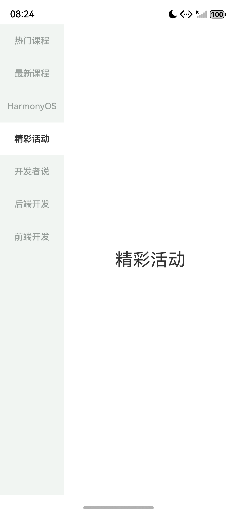

# 作业四 HarmonyOS 纵向 Tabs 分类页面

使用 HarmonyOS `Tabs` 与 `TabContent` 实现题图中的纵向分类导航。默认第四项“精彩活动”选中，右侧标题居中；点击分类或在内容区上下滑动，标题和选中行同步切换。

## 环境

DevEco Studio 6.0.2.640、ArkTS、ArkUI、Stage 模型，HarmonyOS 6.0.2 API 22。2026 年 11 月 2 日在 nova 16 Pro 模拟器编译、安装并验证。

## 实现

- 分类按热门课程、最新课程、HarmonyOS、精彩活动、开发者说、后端开发、前端开发排列。
- `Index.ets` 使用数组和 `ForEach` 生成七个 `TabContent`，`selectedIndex` 默认值为 3。
- `vertical(true)` 和 `BarPosition.Start` 将页签放到左侧，侧栏宽度 27%，每项高 52vp。
- 自定义 `tabBar` Builder 根据同一个索引设置白底深色加粗字或浅底灰字。
- `BarMode.Scrollable` 保留行高，全高 TabBar 配合 `CommonModifier().align(Alignment.TopStart)` 将七项紧凑放到顶部。
- `onChange` 更新索引，因此点击和纵向手势均能刷新选中状态。

## 运行截图

## 验证

七项点击均通过；重复点击当前项稳定；从精彩活动向上滑动进入开发者说，向下滑动返回；冷启动恢复精彩活动。布局树检查确认七项可见、页签顶部对齐、内容居中，侧栏实测约 26.97%。共 12 个运行检查点全部通过。

完整结果见 [verification.json](homework_4/evidence/verification.json)，编译记录见 [build.log](homework_4/evidence/build.log)，截图见 [screenshots](homework_4/screenshots/)。[Word 报告](作业_4_报告.docx)包含关键代码、运行截图和检查表。

## 结论

Tabs 负责页签和内容视图切换，TabContent 提供对应分类页面，onChange 同步真实切页结果。本实验完成题图要求的分类导航和标题页面，未接入网络数据；状态仅保存在当前页面，冷启动使用默认索引。

参考：[OpenHarmony 官方 Tabs 文档](https://github.com/openharmony/docs/blob/master/zh-cn/application-dev/reference/apis-arkui/arkui-ts/ts-container-tabs.md)。
